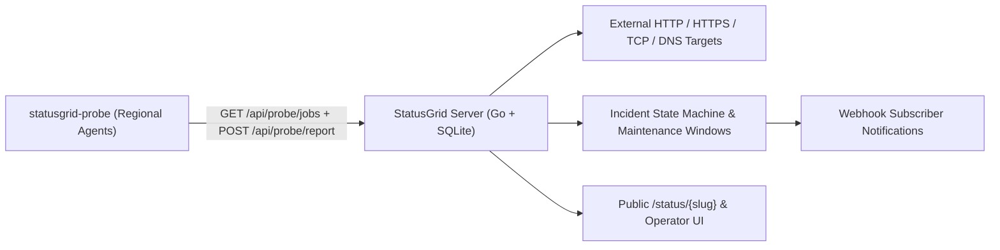

# StatusGrid

Distributed external uptime monitoring, incident lifecycle management, maintenance windows, and public status pages built in Go + SQLite.

## Overview & Problem Statement

While host metrics agents monitor CPU and RAM inside servers, teams also need external availability verification across HTTP/HTTPS endpoints, TLS certificates, TCP ports, and DNS resolution from multiple regions—coupled with automated incident creation, maintenance suppression, and public status pages. StatusGrid provides a central API + web console alongside lightweight distributed `statusgrid-probe` agents.

## Features

- **Multi-Protocol External Monitoring**: HTTP/HTTPS (status codes, body substring assertions, TLS certificate expiry days remaining), TCP dial checks, and DNS record resolution.
- **Distributed Multi-Region Probe Agents**: Run standalone `statusgrid-probe -region eu-central` binaries against `/api/probe/jobs` and `/api/probe/report`.
- **Automated & Manual Incident Management**: Opens incidents automatically after configurable consecutive failures, records timeline updates (`investigating` -> `identified` -> `monitoring` -> `resolved`), and auto-resolves on recovery.
- **Maintenance Windows & Public Status Pages**: Suppress incident alerts during scheduled maintenance windows and publish `/status/{slug}` (HTML & `?format=json`) with webhook subscriber notifications.
- **Dashboard Analytics**: Uptime percentages, SVG latency charts, service grouping, and one-click check triggers.

## Quick Start

1. **Requirements**: Go 1.24+
2. **Clone**: `git clone https://github.com/fully-ai/statusgrid.git && cd statusgrid`
3. **Build Binaries**: `./scripts/install.sh` (Windows: `.\scripts\install.ps1`)
4. **Configure**: Copy `.env.example` to `.env` if setting `STATUSGRID_ADMIN_TOKEN` / `STATUSGRID_PROBE_TOKEN`
5. **Start Central Server**: `./scripts/dev.sh` (Windows: `.\scripts\dev.ps1`)
6. **Optional Regional Probe**: `./bin/statusgrid-probe -server http://127.0.0.1:8094 -region eu-central`
7. **Open**: `http://127.0.0.1:8094` (Public status page at `http://127.0.0.1:8094/status/default`)
8. **Run Tests**: `./scripts/test.sh` (Windows: `.\scripts\test.ps1`)

## Architecture



## Docker Deployment

```bash
STATUSGRID_ADMIN_TOKEN="adm" STATUSGRID_PROBE_TOKEN="prb" docker compose up --build -d
docker compose logs -f
docker compose down
```

## Contributing & License

See [CONTRIBUTING.md](CONTRIBUTING.md), [SECURITY.md](SECURITY.md), and [LICENSE](LICENSE) (Apache 2.0).
